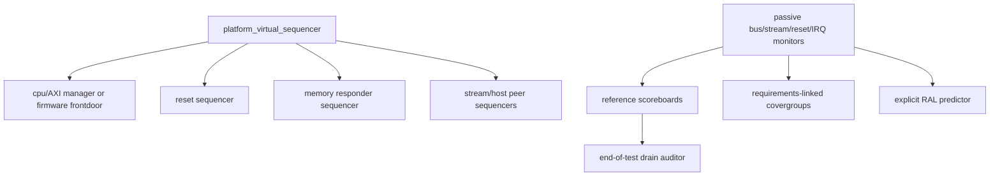

# Shared UVM／CRV 與六類 coverage 驅動驗證計畫 v0.2

2026-11-01。design proposal，提供中央三產品計畫匯入；本工作不寫中央 `verification/`。**先完成真實 SoC 整合與 elaboration，再執行逐產品 UVM closure**。已執行有界 APB fixture RTL campaign／export-policy self-tests；後續新增APB UVM資產通過原生嚴格語法／語義前端，但沒有UVM simulation PASS、SoC PASS或六類100%。最新結果見[UVM執行資產與相容性](platform_uvm_execution.md)。

## 1. Gate 與責任分工

|gate|integration 提供|platform／verification 提供|目前狀態|
|---|---|---|---|
|G0 source/config|產品 hierarchy、完整 filelist、source commits/blobs、defines/parameters、clock/reset/address/IRQ/frame map、缺 IP 清單|agent role與實際 ports/config 比對|僅APB fixture有可建置snapshot；完整TV/STB/IPCAM BLOCKED|
|G1 elaboration|real RTL top；no unresolved module／width／multiple-driver；逐產品固定工具|UVM package、interfaces、bind、RAL及測試compile；pin hierarchy matches|Icarus fixture elaboration通過；完整SoC與UVM elaboration BLOCKED|
|G2 directed correctness|reset／memory／IRQ／adapter contract|獨立scoreboard、nonzero check/transaction、negative/mutation與timeout|APB fixture bounded checks通過；其他待做|
|G3 CRV regression|核准SKU配置與bounded memory service model|合法／錯誤campaign、固定seed/replay、raw DB與hole報告|fixture procedural seeded campaign已執行；不是UVM regression|
|G4 closure|逐產品scope及工具支持簽認|六類100%、SVA零失敗、waiver審核、artifact可重現|全部OPEN/BLOCKED，沒有closure宣稱|

stub/TLM 可用於早期驗證bench，但必須標 `build_kind=model`，不能通過產品RTL gate。功能缺失不是unreachable code，缺RTL／工具不支持不能排除成100%。

## 2. 共用 UVM 組件合約（APB資產已通過靜態前端；其餘仍為計畫）

|組件|transaction／責任|禁止混淆|
|---|---|---|
|platform_cfg|product、config hash、build/source fingerprint、addresses、clock/reset domains、agent active/passive、seed、timeouts、legal feature set|feature未確認填BLOCKED；不從README峰值推導constraint|
|apb_agent|setup/access、PSTRB/PPROT、wait/error；monitor發 accepted/completed events與reset epoch|fixture用active manager；有CPU RTL時改passive或firmware frontdoor，不能兩個driver爭bus|
|axi_agent|獨立AW/W/B/AR/R、ID/outstanding、W-first、backpressure、response errors；memory responder可亂序不同ID|active memory model只用於DDR邊界未接前；真DDR/controller整合後切正確角色並重跑|
|stream_agent|byte/pixel profile adapter、TKEEP/SOF/EOL、stall stable、不可回壓來源drop observation|不把generic packet TLAST當frame完成；plane/line metadata要用已凍結版本|
|host_peers|I2C target／SPI/QSPI flash／MDIO PHY／SDIO card responders＋wire monitors|既有主動host driver無法直接驗host DUT；依platform_host_contracts逐項反向實作|
|ral_env|adapter、bus2reg、explicit predictor、frontdoor reset/value/access tests|先只建立已存在register；本fixture兩個256-word RAM用uvm_mem，不冒充五種host CSR已存在|
|memory_sb|獨立byte-address reference、strobe mask、合法aperture/alias、read snapshot/完成時點|不能讀DUT memory array產生golden；同址read/write policy先凍結，不以race waive mismatch|
|frame_ownership_sb|slot/generation/context、唯一writer、pending+active consumer tokens、publish/abort/quarantine|READY須最後OKAY BRESP，FREE須token與outstanding均0；不是只看SOF/TLAST|
|qos_sb|每client accepted bytes、service gap、deadline/age/credit與debt|沒有DDR服務上界時只報observed latency，deadline property為BLOCKED，不假設零延遲|
|reset_drain_sb|每域reset epoch、已接受AXI ID清單、W/R/B未完成、completion一次終態|timeout不是drain完成；peer永久無回應需system隔離ack，不能本地reset後直接free|

RAL fixture map：memory0/page0、memory1/page1；每個memory slow alias須用normalized bank+word predictor key，避免兩份mirror分裂。APB4→APB3 adapter full-word-only，partial-write測試預期error而非mask成功。IRQ是target事件，不是CPU interrupt完成；產品的IRQ controller/RAL map待integration固定。

scoreboard由**monitor接受／完成事件**更新；sequence只提供刺激與預期測試意圖，不能把driver回傳值複製當golden。reference model與RTL address/FSM邏輯獨立開發；wire payload、CRC/packing用外部向量或獨立演算法交叉核對。每個checker需至少一個能讓它報錯的mutant／負向trace，保留查核點數。

## 3. Virtual sequences／campaign 與需求追溯

每個產品在中央矩陣以 `TV.PLAT.*`、`STB.PLAT.*`、`IPCAM.PLAT.*` 各自建立需求ID；下列PLAT ID可共用測試實作，但不得共用產品結果。權重是候選run配置，不是產品需求。

|ID／virtual sequence|合法constraint／traffic|錯誤campaign（與合法分開）|oracle／功能bins|依賴／本輪結果|
|---|---|---|---|---|
|PLAT-BUS-01 csr_ral_vseq|合法aligned addresses、full-word fixture；真APB4 target才測byte strobes；AW/W獨立skew|hole、misalignment、invalid strobes、PSLVERR|memory golden、bank×R/W×fast/slow×response；reset-value與alias|fixture每seed209tx，已跑；UVM/RAL未跑|
|PLAT-BUS-02 axi_concurrency_vseq|ID與outstanding在CAP內；INCR burst≤max、4KB split；read/write同時|bad ID/size/length、SLVERR/DECERR、missing/early LAST peer fault|每IDrequest/response ledger、AW/W配對、no loss/duplicate|AXI fabric／DMA RTL未整合，BLOCKED|
|PLAT-STR-01 packing_vseq|descriptor合法format/depth/stride、tail lane/line/plane、可回壓stall|SOF/EOL缺失、TKEEP非法、不可回壓overflow|獨立byte pattern、line/frame大小、drop恢復|adapter/stream RTL缺失，BLOCKED|
|PLAT-DMA-01 pattern_dma_vseq|source→writeDMA→buffer→readDMA→sink；多plane/ring wrap|越界/overflow/domain/epoch、AXI error、completion full|獨立address memory與descriptor parser、payload比對|DMA/frame manager缺失，BLOCKED|
|PLAT-OWN-01 multi_consumer_vseq|writer lease、1..CAP consumers、pending/acquire/release|doublewriter／doublefree／stale generation／跨domain|slot狀態與token守恆、reuse前drain|ownership RTL缺失，BLOCKED|
|PLAT-RST-01 reset_power_vseq|quiescent reset、各域phase sweep、gate/wake合法次序|active AXI／stream／APB中reset、missing reset ack|epochs、pins安全值、no phantom completion|fixture只跑quiescent reset；其餘BLOCKED|
|PLAT-DRN-01 abort_drain_vseq|STOP/ABORT在descriptor/plane/line/burst各phase|peer late/never B/R、partialW、IRQ與W1C競爭|accepted IDs全部結算後才drain_done，quarantine終態|相關RTL缺失，BLOCKED|
|PLAT-QOS-01 contention_vseq|多client、重疊峰值、bounded service stalls、不同權重|超出admission／starvation／deadline miss|每client最大gap／deadline與FIFO高水位|service contract未知，BLOCKED；不可用平均頻寬PASS|
|PLAT-HOST-01 role_peer_vseq|依五host凍結模式，target responder可stretch/busy|NACK/TA missing/CRC/busy timeout/OE contention|wire monitor＋payload＋CSR/IRQ終態|五host未實作，BLOCKED|
|PLAT-SEC-01 domain_vseq|trusted context下合法DMA/aperture/secure scrub|偽造domain／越權範圍／secure→nonsecure reuse|獨立policy oracle，無越權AXI／無未驗資料發布|firewall/IOMMU/context缺失，BLOCKED|

合法campaign：先滿足protocol invariant，再在合法值中偏重burst/line/ring/4KB邊界（候選70%通常值／30%邊界）。錯誤campaign一次注入一類、檢查預期error/recovery，之後再做多錯誤競爭；非法刺激不能污染合法功能bins，也不能以DUT assertion failure當作預期成功。環境protocol-error checker與DUT安全assertion分開分類；DUT assertion須零失敗。

## 4. 六類 100% 的分母與判定

逐 **product × config × scope** 記錄 `raw_total/raw_hit`、核准排除清單、`effective_total/effective_hit`。`effective_total=raw_total-approved_excluded`；所有有效點hit才是該scope100%。raw=0或effective=0不能報100%，需N/A審查且不能取代產品required scope。

|類別|raw coverage points／有效關閉目標|額外證據與禁止事項|
|---|---|---|
|line|instrumented可執行statement/line IDs；effective全部hit|固定compiler/source map，不能把缺檔或未編入required RTL當已排除|
|FSM|**states與arcs分開分母**；每state及每合法arc均hit|保留工具FSM提取與encoding/arc mapping；只有state百分比不算FSM100%；工具無arc支援則BLOCKED|
|toggle|每bit 0→1與1→0各自point，兩向全hit|clock/reset/testbench scope與functional activity分列；tie-off需真實config evidence與逐點核准，不直接批量排除|
|branch|每條件合法taken/not-taken point；case branch各自hit|與line不同分母；工具不支持不以line代替|
|SVA|每assert ID：attempts、antecedent_hits、nonvacuous_passes、failures、對應cover witness|failures=0；有效assert必須antecedent/nonvacuous/witness>0；disabled/reset-only/vacuous pass不關閉；failure不可waive成100%|
|functional|每個合法bin／cross有requirement ID、config legality與sample事件|covergroup明確ignore/illegal合法性；不可把未實作feature bins刪除以達標；repeated label不是新的SKU coverage|

APB fixture需要state+arc的hierarchy範圍是 `dut.memory0.state` 與 `dut.memory1.state`；router／adapter是comb邏輯，無內部FSM。不能發明router FSM point；是否不適用由scope review記錄，不能讓缺DMA FSM從產品分母消失。fixture的6個coarse campaign counters不是完整functional covergroup分母。

排除只限source/config證明不可能或核准out-of-scope點；記錄point ID、理由、reviewer、approval ID、source/config fingerprint與證據。工具unsupported、missing RTL、未寫sequence、deadline未知不是waiver理由。raw與effective報表並列，留原始unmerged DB及waiver檔案。

## 5. 固定 seed／replay／同一建置才能合併

run identity至少包含product、config SHA256、scope、所有repo source commits/blobs+內容hash、filelist/defines/parameters hash、testbench/reference SHA、tool/version、coverage instrumentation flags、UVM版本／編譯庫hash。seed與test name另外記錄。工具不只以major version認同；兩個產品即使同RTL也不能合併成產品100%。

只在上述identity完全相同、coverage point inventory完全相同時，對不同seed/test的hit做聯集；分母不相加、ID不碰撞、waiver不得隨seed變動。不同SHA/config/tool/instrumentation/產品嚴禁merge。新增RTL／constraint變動後建立新baseline並重跑受影響scope，不沿用舊100%。

每run保存command／environment／seed／scenario、raw tool DB及SHA256、exporter ID/version、UVM report summaries、assertion與scoreboard失敗、transaction/accepted bytes、reset epoch與結束時未清ledger。timeout或scoreboard error不能用coverage高覆蓋蓋過；缺rawDB不關閉。

本輪新增 `ipcheck/platform/coverage/check_export.py` 是**匯出格式與判定政策的防呆檢查器，不是coverage DB parser**；它比對baseline identity/point inventory、核准排除、FSM states+arcs、SVA非vacuous及功能requirement。approval檔與baseline必須由中央review流程提供；此工具不驗證reviewer身份或DB工具來源真偽。實際report exporter與rawDB parser仍待選工具實作，不能手填measured即稱驗證完成。

`test_check_export.py` 19個**synthetic policy** tests通過：不相容identity、無DB、unsupported、未核准排除、FSM缺arc、SVA vacuous/failure、非法功能bin、缺RTL、coverage hole均拒絕；另拒絕timeout／未drain／缺UVM summary／UVM error／單向toggle／重複baseline分母／illegal-bin hits。合法核准排除保留raw分母；以新案例回跑舊版失敗、修正版通過。synthetic「all-hit」只驗政策程式，不是任何產品coverage證據。

## 6. 本輪實際結果與下一步

paired IP文件 `docs/design/platform_slice_baseline.md` 與 `integration/platform/baseline.json` 提供有界fixture source pins／clock/reset/address/IRQ；不是中央SoC top。`run_slice.py`：3 labels×3 seeds、每run209tx且739/741/739 checks，固定seed replay相同；partial-write mutant被獨立地址／memory golden抓到。此為procedural constrained random harness，不是UVM constrained class、covergroup或SVA regression。

完整TV/STB/IPCAM SoC elaboration、UVM simulator build/runtime、AXI memory/DMA/ownership/QoS/reset-drain驗證與六類raw coverage DB均BLOCKED/OPEN。官方UVM來源已定位與固定；Verilator5.032對兩個版本均有type_id解析錯誤，隔離5.052建置又遇WSL服務無法啟動。APB UVM資產已以原生pyslang12.1.0嚴格前端檢查到error=0，但這不等於UVM模擬或runtime topology已驗證。診斷與失敗logs均保留，不能宣稱已支持所需全部coverage。

下一步由integration提供逐產品real top/filelist/fingerprint及缺IP解決狀態，再由platform實作UVM bus/RAL predictor與virtual seq，先跑directed/mutation；選定有FSM arc/SVA非vacuous/branch支援的工具後導出rawDB，依holes加seed／sequence。工具與依賴未凍結，完成ETA未知。不得自動合併、付費或以教育slice宣稱production能力。
